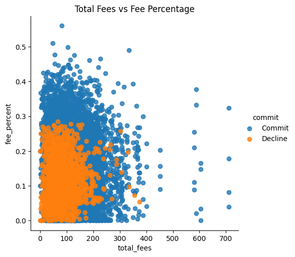
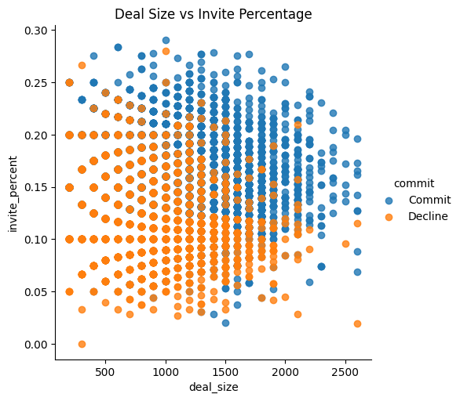
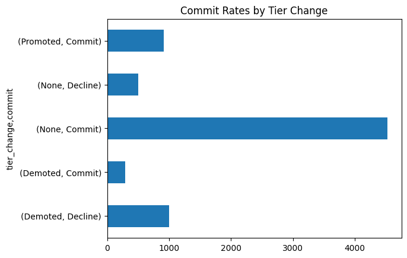

# 📊 Investor Commitment Prediction & Analysis


## 📌 Executive Summary
This project analyses institutional investor behavior in syndicated loan deals and builds a machine learning pipeline to predict whether an investor will **commit to or decline** a loan invitation. By leveraging financial metrics (deal size, fee share, interest rates) and historical relationship data (tier promotions/demotions), this model provides actionable insights to optimize syndication strategies and maximize deal participation.

## 🎯 Project Objectives
* **Exploratory Data Analysis (EDA):** Identify key drivers behind investor decisions.
* **Feature Engineering:** Derive new metrics such as Fee Percentage and Deal Invite Percentage to better capture the economics of each deal.
* **Predictive Modeling:** Train and tune multiple classification algorithms to accurately forecast investor declines, enabling proactive risk management in deal structuring.

## 📂 Dataset Overview
The analysis utilizes two datasets (`investor_data.csv` and `investor_data_2.csv`) comprising over 7,200 historical loan invitations. Key features include:
* **Deal Financials:** `deal_size`, `total_fees`, `fee_share`, `int_rate`, `covenants`.
* **Investor Relationship:** `investor` (Bank Name), `prior_tier`, `invite_tier`.
* **Target Variable:** `commit` (Commit vs. Decline).

## 📈 Key Insights & Exploratory Data Analysis

### 1. Fee Structure Impact
The relationship between total fees and the percentage of the fee allocated to the investor plays a critical role. Investors receiving a fee percentage greater than 30% show a significantly higher commit rate.




### 2. Deal Allocation
Similarly, the proportion of the total deal size offered to the investor (`invite_percent`) heavily influences their likelihood to participate. Larger deal sizes with strategic invite proportions yield higher commitment levels.



### 3. Tier Dynamics
Investors who retain their status as "Bookrunners" have the highest commitment volume. Conversely, demotions to "Participant" status correlate with an increased likelihood of declining a deal.




## ⚙️ Methodology & Machine Learning Pipeline

1. **Data Preprocessing:** 
   * Filtered out invalid entries (e.g., negative total fees).
   * Handled categorical encoding using `pd.get_dummies()`.
   * Performed a stratified 80/20 Train-Test split to maintain class balance.
2. **Feature Engineering:**
   * `tier_change`: Categorized historical relationship shifts (Promoted, Demoted, None).
   * `fee_percent`: Calculated as `fee_share / total_fees`.
   * `invite_percent`: Calculated as `invite / deal_size`.
3. **Model Selection & Tuning:**
   Built Scikit-Learn pipelines utilizing `StandardScaler` and applied `GridSearchCV` with 5-fold cross-validation to tune the following models:
   * **Logistic Regression (L1 & L2 Penalties):** Baseline linear models for interpretability.
   * **Random Forest Classifier:** To capture non-linear relationships.
   * **Gradient Boosting Classifier:** For robust, sequential error reduction.

## 🏆 Results & Model Performance

The models were evaluated using the **Area Under the Receiver Operating Characteristic Curve (AUROC)**. The Gradient Boosting model outperformed the others, demonstrating exceptional predictive capability for investor behavior.

| Model | AUROC Score |
| :--- | :--- |
| **Gradient Boosting** | **0.9691** |
| Random Forest | 0.9595 |
| Logistic Regression (L1) | 0.9522 |
| Logistic Regression (L2) | 0.9518 |

## 🚀 How to Run

1. Clone the repository:
   ```bash
   git clone https://github.com/fintech-rohan/capital-markets-classifier.git
   ```
2. Install the required dependencies:
   ```bash
   pip install pandas numpy matplotlib seaborn scikit-learn
   ```
3. Run the Jupyter Notebook or Python script to view the EDA and model training process.

---
*Developed to demonstrate quantitative analysis, feature engineering, and predictive modeling applied to financial markets.*